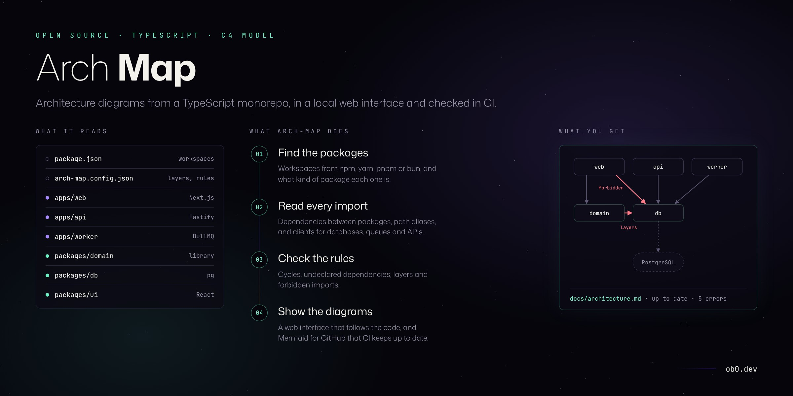
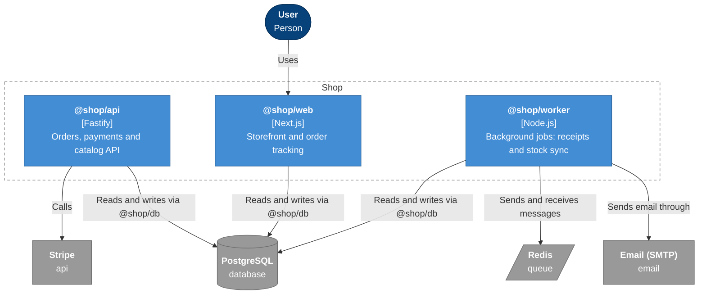
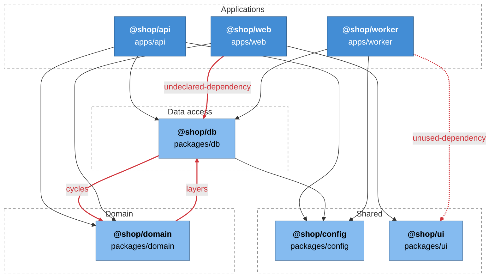
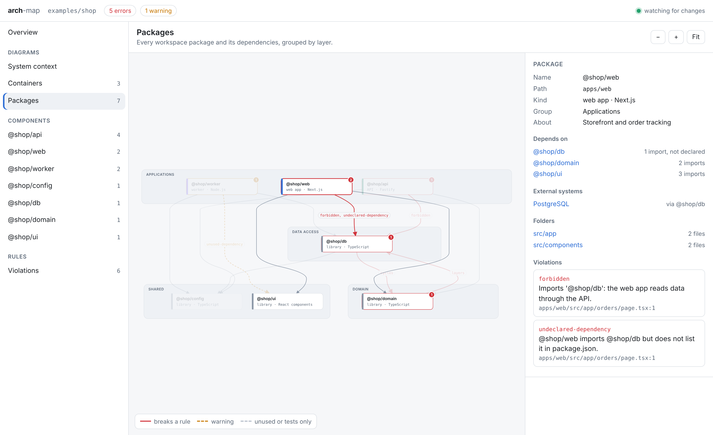
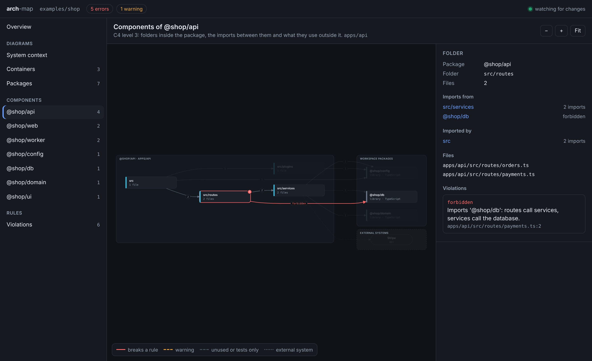

# arch-map

[](https://github.com/oebh2408/arch-map/actions/workflows/ci.yml)


Architecture diagrams of a monorepo are usually drawn by hand once and then go out of date: a new package is added, the web app starts importing the database layer directly, two libraries end up depending on each other. Nobody notices until the diagram is needed and turns out to be wrong.

arch-map builds the diagrams from the code. It reads the workspace packages, their `package.json` files and every import, and writes `docs/architecture.md` with [C4](https://c4model.com) diagrams in Mermaid, which GitHub renders in place. It also checks rules (cycles, undeclared dependencies, layers, forbidden imports) and a CI step fails when the committed document is out of date, so the diagrams change in the same pull request as the code. `arch-map serve` opens the diagrams in a local web interface that updates as the code changes, and `arch-map view` writes the package graph as a single HTML file.



<sub>Run on [examples/shop](examples/shop), a small monorepo with violations planted on purpose.</sub>

## Example

These diagrams are generated from [examples/shop](examples/shop), a small monorepo with a web app, an API, a worker and four libraries. The full document is [examples/shop/docs/architecture.md](examples/shop/docs/architecture.md).

Containers, with the external systems each one reaches directly or through a library:



Packages by layer. Red edges break a rule: the domain package imports the data access package (a layer violation and a cycle), and the web app imports the database package directly without declaring it.



## What it produces

| Section | Level | Content |
| --- | --- | --- |
| System context | C4 level 1 | The system, its users and the external systems it talks to |
| Containers | C4 level 2 | Deployable packages (web apps, APIs, workers, CLIs) and the external systems they use, including through libraries |
| Package dependencies | | Every workspace package and its dependencies, grouped by layer; test-only and unused dependencies dashed; violations in red |
| Components | C4 level 3 | Folders inside each package, the imports between them, and the libraries and external systems each folder uses |
| Rule check | | Table of violations with file and line |

`--format structurizr` writes the same model as a [Structurizr DSL](https://docs.structurizr.com/dsl) workspace, and `--format json` writes the raw model.

### How packages are classified

| Kind | When |
| --- | --- |
| Web app | Depends on Next.js, Remix, Nuxt, SvelteKit, Astro, Angular, Vue, Svelte or React DOM and has a `dev` or `start` script, or lives under `apps/`. A library that depends on React is shown as a component library. |
| API | Depends on NestJS, Fastify, Express, Hono, Koa, tRPC or GraphQL Yoga |
| Worker | An application that depends on a queue library (BullMQ, KafkaJS, amqplib, pg-boss) or has `worker` or `jobs` in its path |
| CLI | Has a `bin` field |
| Library | Everything else |

Override it per package in `package.json`:

```json
{ "archMap": { "kind": "worker", "technology": "Node.js, BullMQ", "description": "Sends receipts" } }
```

External systems are detected from client libraries: `pg`, `mysql2`, `mongodb`, `redis`, `ioredis`, `bullmq`, `kafkajs`, `amqplib`, `nodemailer`, `stripe`, `twilio`, LLM SDKs and others. Add your own in the config under `externals`.

## Web interface

```sh
npx arch-map serve
```

This starts a local server on http://localhost:4200 with the same model as the generated document: the system context, the containers, the package graph, the components of each package and the rule violations. The overview lists the packages and the external systems they use.



In the package graph, packages are grouped by layer, or into applications and libraries when there are no layers. Red edges break a rule and amber ones are warnings, and dashed grey ones are dependencies that are declared but unused or only used by tests. Click a package to see what it depends on, what depends on it, the external systems it reaches and its folders; the rest of the graph fades. The components view shows the folders of one package, the files in each and the imports between them, with forbidden imports in red. Clicking a violation opens the view where it happens and selects it.



The model is rebuilt when a file in the repository changes (`node_modules`, `.git` and build folders are ignored), so the diagrams follow the code while you work. The server only listens on 127.0.0.1 and rejects requests with a different `Host` header. It follows the system light or dark theme.

`arch-map view` writes the package graph as a single self-contained HTML file (no scripts or fonts loaded from the network), to attach to a pull request or a design document.

## Rules

| Rule | Default | What it finds |
| --- | --- | --- |
| `cycles` | error | Workspace packages that depend on each other in a cycle |
| `undeclared-dependency` | error | A package imports another workspace package without listing it in `package.json`. It works locally because of hoisting and breaks when the package is built or deployed on its own. |
| `unused-dependency` | warning | A workspace package listed in `package.json` that is never imported |
| `layers` | error | A package depends on a package in a higher layer |
| `forbidden` | error | An import that matches a forbidden rule, at package or folder level |

## Install

Installed from GitHub; it is not published to npm.

```sh
npm install --save-dev github:oebh2408/arch-map
```

## Usage

```sh
npx arch-map generate                 # writes docs/architecture.md
npx arch-map check                    # prints violations, exits 1 on errors
npx arch-map check --up-to-date docs/architecture.md
npx arch-map serve                    # web interface on http://localhost:4200
npx arch-map view                     # writes architecture.html
npx arch-map generate --format structurizr --out docs/workspace.dsl
```

Workspaces are read from `package.json` (`workspaces`, as used by npm, yarn and bun) or `pnpm-workspace.yaml`. A repository without workspaces is treated as one package. Path aliases from `tsconfig.base.json` or `tsconfig.json` are resolved.

### Config

`arch-map.config.json` in the repository root:

```json
{
  "name": "Shop",
  "layers": [
    { "name": "Applications", "packages": ["apps/*"] },
    { "name": "Data access", "packages": ["packages/db"] },
    { "name": "Domain", "packages": ["packages/domain"] },
    { "name": "Shared", "packages": ["packages/config", "packages/ui"] }
  ],
  "forbidden": [
    { "from": "apps/web/**", "to": "packages/db/**", "reason": "the web app reads data through the API" },
    { "from": "apps/api/src/routes/**", "to": "packages/db/**", "reason": "routes call services, services call the database" }
  ],
  "externals": {
    "@acme/billing-client": { "name": "Billing service", "kind": "api" }
  },
  "ignore": ["**/*.generated.ts"],
  "rules": { "unused-dependency": "off" }
}
```

Layers are ordered from top to bottom. A package may depend on packages in its own layer and the layers below. Packages that match no layer are not checked.

`forbidden` globs are matched against file paths relative to the root, package directories and package names, so a rule can target a whole package (`packages/db/**` or `@shop/db`) or a folder inside one.

## In CI

```yaml
name: architecture
on: [pull_request]
jobs:
  check:
    runs-on: ubuntu-latest
    steps:
      - uses: actions/checkout@v4
      - uses: actions/setup-node@v4
        with:
          node-version: 22
      - run: npx -y github:oebh2408/arch-map check --format github --up-to-date docs/architecture.md
```

`--format github` turns violations into annotations on the pull request. To update the document automatically instead of failing, run `arch-map generate` in a job that commits the result.

## Library

```ts
import { buildModel, checkRules, loadConfig, renderMarkdown, renderViewer } from 'arch-map';

const config = loadConfig('.');
const model = buildModel('.', config);
const violations = checkRules(model, config);
console.log(renderMarkdown(model, config, violations));
const html = renderViewer(model, config, violations);
```

`serve` and `createArchMapApp` start the web interface or return its request handler. `packagesView`, `contextView`, `containersView`, `componentsView` and `layout` return the views it draws, laid out as SVG.

## Limits

- Dependencies come from imports and `package.json`. Calls between deployed services over HTTP or queues are not visible in imports, so the container diagram does not draw edges between containers.
- External systems are only found for known client libraries or the ones you add to `externals`.
- Type-only imports count as dependencies. For layering that is usually what you want.
- Components are folders. Depth is one level below `src/`, `app/` or `lib/`; change it with `componentDepth`.
- Imports are read with the TypeScript preprocessor, without type checking, so it is fast but does not follow re-exports through barrel files to the original module.

## Design decisions

- [0001 · Generate diagrams from the code, check them in CI](docs/adr/0001-diagrams-from-code.md)
- [0002 · Workspace packages as C4 containers, folders as components](docs/adr/0002-packages-as-containers.md)
- [0003 · Read imports with the TypeScript preprocessor](docs/adr/0003-import-scanning-without-type-checking.md)

## Development

```bash
npm install
npm test
npm run build && npm run example   # regenerates examples/shop/docs/architecture.md
npm run demo:svg                   # re-renders docs/demo.svg from the real output
npm run build && node dist/cli.js serve examples/shop
npm run screenshots                # regenerates the interface images, needs a local Chromium
```

## License

MIT © [Oscar Benavides](https://ob0.dev)
