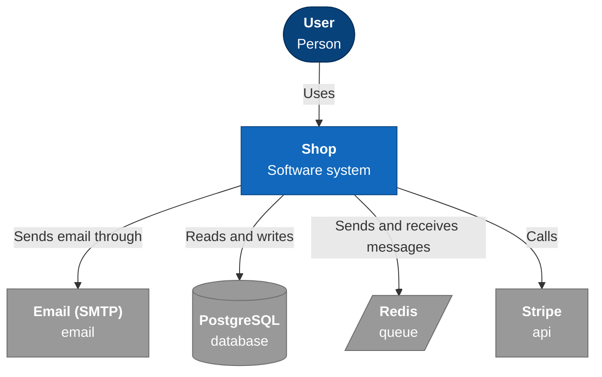
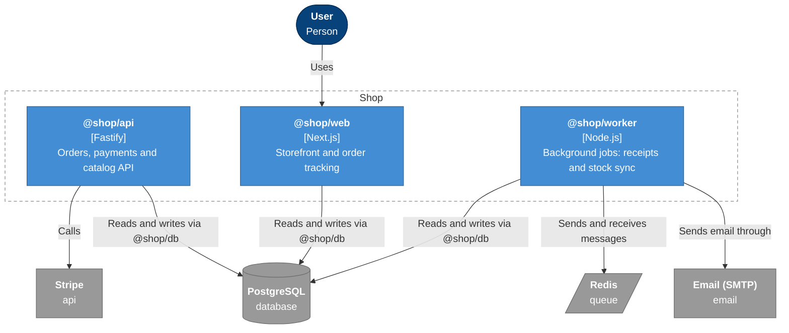
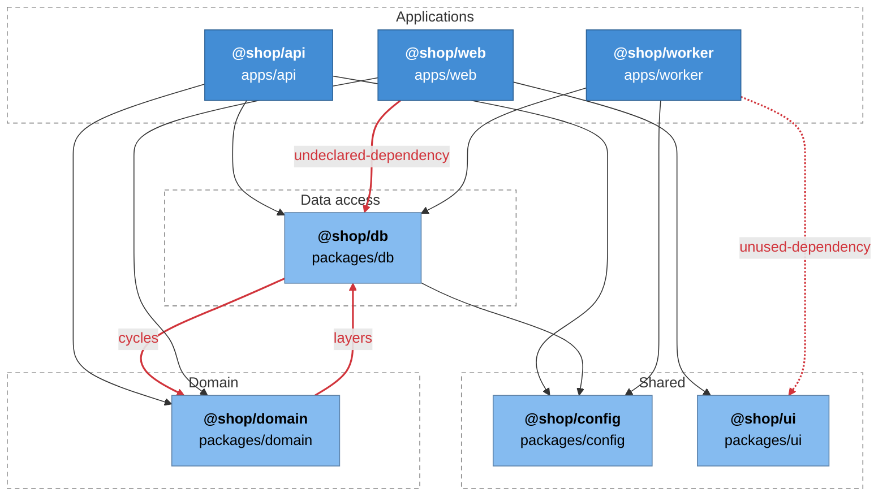
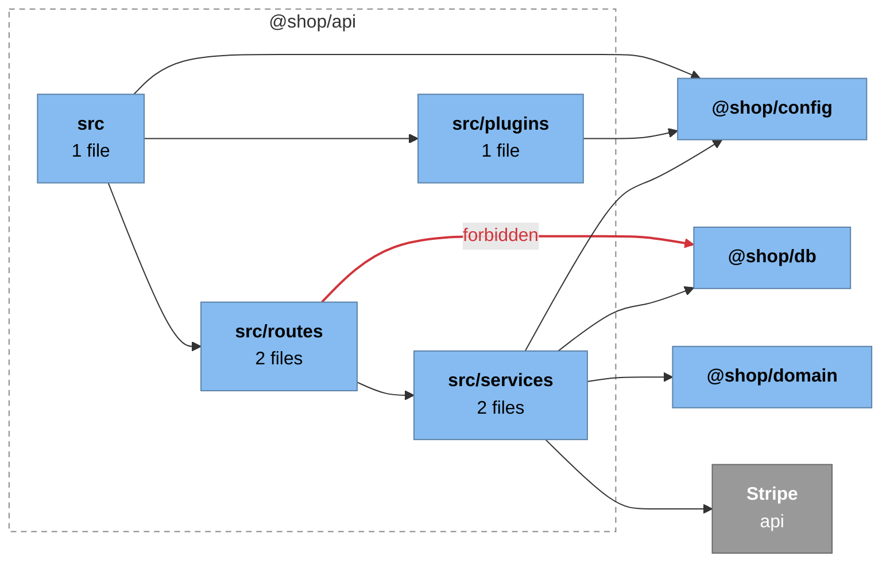
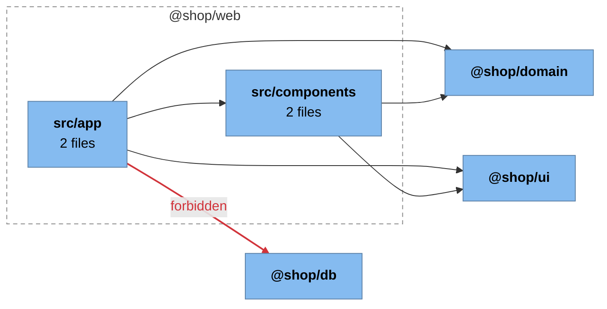
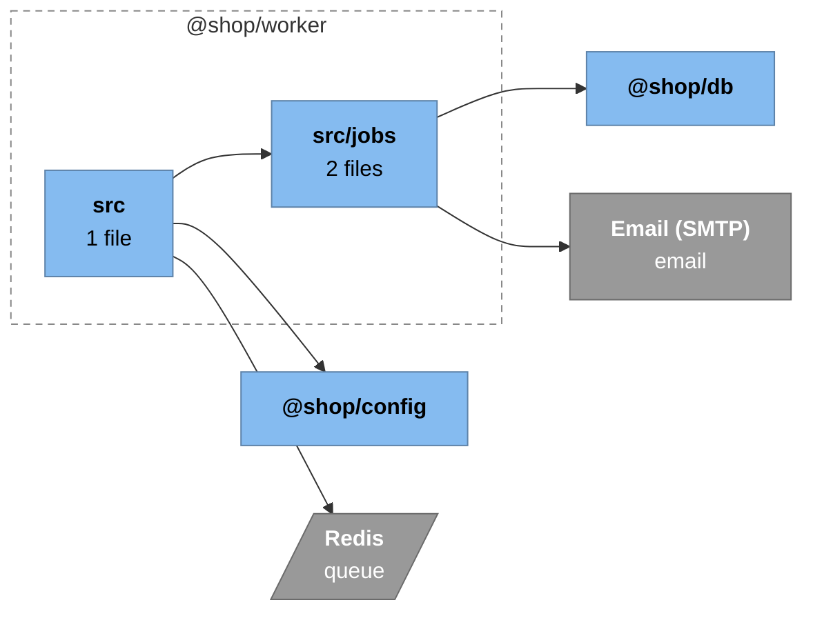

# Architecture: Shop

<!-- Generated by arch-map. Do not edit by hand: run `npx arch-map generate`. -->

7 packages, 11 dependencies between them, 4 external systems.

## System context

## Containers

| Package | Kind | Technology | Path | Description |
| --- | --- | --- | --- | --- |
| @shop/api | API | Fastify | `apps/api` | Orders, payments and catalog API |
| @shop/web | Web app | Next.js | `apps/web` | Storefront and order tracking |
| @shop/worker | Worker | Node.js | `apps/worker` | Background jobs: receipts and stock sync |
| @shop/config | Library | TypeScript | `packages/config` | Environment settings |
| @shop/db | Library | TypeScript | `packages/db` | Queries and migrations |
| @shop/domain | Library | TypeScript | `packages/domain` | Orders, money and pricing rules |
| @shop/ui | Library | React components | `packages/ui` | Shared React components |

### External systems

| System | Kind | Detected from | Used by |
| --- | --- | --- | --- |
| Email (SMTP) | email | `nodemailer` | @shop/worker |
| PostgreSQL | database | `pg` | @shop/db |
| Redis | queue | `bullmq` | @shop/worker |
| Stripe | api | `stripe` | @shop/api |

## Package dependencies

Layers, from top to bottom: Applications, Data access, Domain, Shared. A package may depend on its own layer and the ones below it.

Dashed edges are test-only or unused dependencies. Red edges break a rule.

## Components

Folders inside each package and the imports between them.

### @shop/api

### @shop/web

### @shop/worker

## Rule check

| Rule | Severity | Location | Message |
| --- | --- | --- | --- |
| forbidden | error | `apps/api/src/routes/payments.ts:2` | apps/api/src/routes/payments.ts imports '@shop/db': routes call services, services call the database. |
| forbidden | error | `apps/web/src/app/orders/page.tsx:1` | apps/web/src/app/orders/page.tsx imports '@shop/db': the web app reads data through the API. |
| undeclared-dependency | error | `apps/web/src/app/orders/page.tsx:1` | @shop/web imports @shop/db but does not list it in package.json. |
| unused-dependency | warning | `apps/worker/package.json` | @shop/worker lists @shop/ui in package.json but never imports it. |
| cycles | error | `packages/db/src/orders.ts:1` | Dependency cycle: @shop/db -> @shop/domain -> @shop/db. |
| layers | error | `packages/domain/src/order.ts:1` | @shop/domain (layer Domain) depends on @shop/db (layer Data access), which is above it. |
